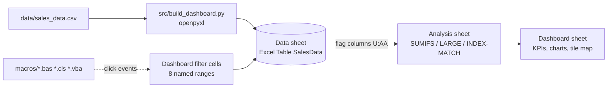

# Architecture

## Layers


| Sheet | Role |
|---|---|
| `Dashboard` | Presentation only. Filter cells (named ranges `sel_*`), KPI cards, highlights, 6 charts, tile map. Protected; only the filter cells are unlocked. |
| `Analysis` | Calculation layer. KPI block, monthly table, one *block* per dimension (category, channel, customer, country, product), highlights. |
| `Data` | Source rows (A:L) + derived columns (M:T) + filter flags (U:AA). Excel Table `SalesData`. |
| `Lists` | Dropdown sources. |
| `Guide` | In-workbook documentation. |

## The filter engine (why every visual responds to every filter)
Each row of `Data` carries a flag:

```
In Filter (U)  = 1 if the row passes ALL 7 conditions
                 (Region, Country, Channel, Customer, Category, Product, Month range)
Flag excl. X   = 1 if the row passes every condition EXCEPT X     (V:AA)
```
Every aggregate is a `SUMIFS(metric, flag, 1, ...)`.

* KPIs, highlights, product chart use the matching flag.
* A chart for dimension *X* uses `Flag excl. X`, so **its own filter is ignored** and all items stay visible. A `Selected` column (`value if item = selection or selection = "All" else 0`) and an `Excluded` column (`value - selected`) feed a **stacked bar**: selected items are coloured, the rest are grey. This reproduces Power BI's highlight-style cross-filtering without VBA.

## Sorting without dynamic arrays
Charts need sorted data but must work in any Excel version. Each block builds a rank key `value + ROW()/1e6` (tie-break), then `LARGE(key, n)` + `MATCH` + `INDEX` produce the sorted list.

## Cross-filter by click (optional)
`macros/` wires `Chart.MouseDown` (via a `WithEvents` class) to the filter cells using `GetChartElement` to resolve the clicked point on the first click. Charts are identified by their top-left cell (`B17`, `L17`, `L36`, `B55`, `L56`, `P56`). Tile clicks use `Worksheet_SelectionChange`.

## Design decisions
* **Formulas over pasted values** so the file is auditable and refreshes when data changes.
* **Plain ranges, not structured references** in `SUMIFS`: identical results, and the recalculation test can run in LibreOffice.
* **Generated, not hand-built**: the workbook is reproducible from CSV; layout changes are code reviews, not binary diffs.
* **Tile map instead of a filled map**: Excel's filled-map chart is a `chartEx` part that openpyxl cannot write.

## Known limitations
* No real PivotTables / slicers / timeline (cannot be generated by openpyxl). See `docs/pivot-build-guide.md` for the manual route.
* Ranges cover the rows present at build time; add rows by re-running the builder.
* Chart-click filtering needs desktop Excel and macros; it is not testable in CI.
* Rendering/visual QA is done in LibreOffice; fine typography can differ slightly in Excel.
